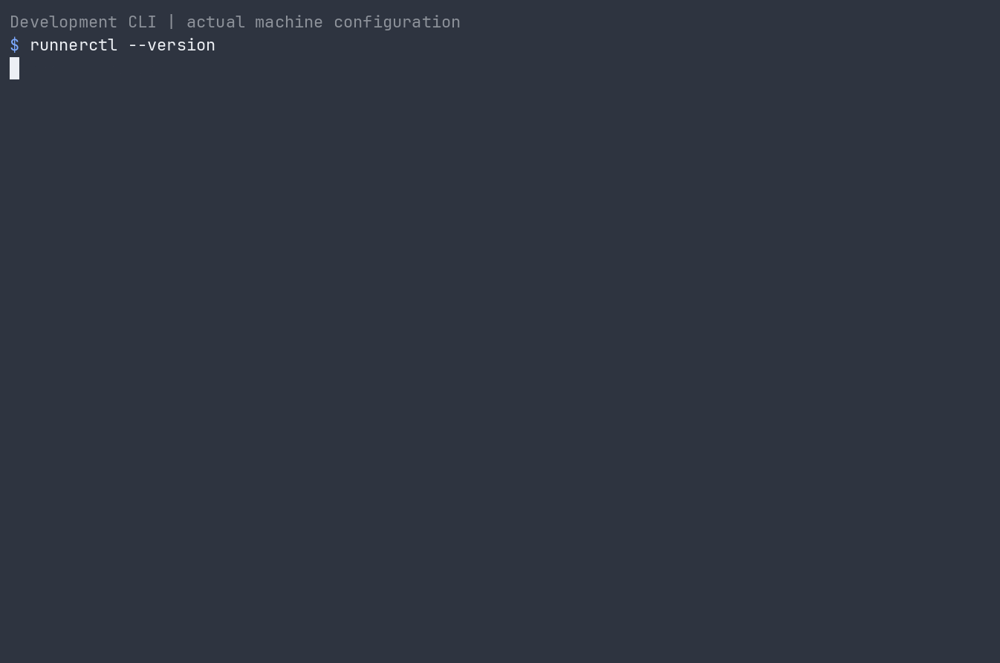

# gitlab-runnerctl

Converge dedicated rootless Podman GitLab Runner instances, one system account per instance.

[](https://github.com/abnertu/gitlab-runnerctl/actions/workflows/validate-runner-controller.yml?query=branch%3Amain) [](https://www.python.org/)



Recorded from the current machine. Personal identifiers are redacted; runtime checks remain deferred.
See the [recording sources](docs/assets/demo/README.md).

## Install

Requirements:

- Arch Linux, the only supported host platform;
- Podman 4.2.0 or later, with aardvark-dns later than 1.10.0;
- systemd with user managers;
- Python 3.13 or later, and [nix-adapter](https://github.com/abnertu/nix-adapter) 0.9.0 or later.

Build it with Nix:

```bash
nix build "github:abnertu/gitlab-runnerctl"
./result/bin/runnerctl --version
```

Without Nix, install nix-adapter from its tag first:

```bash
pip install git+https://github.com/abnertu/nix-adapter@v0.9.0
pip install git+https://github.com/abnertu/gitlab-runnerctl
```

## Configure

Write one TOML file for each instance, and name it after the environment that it serves. `frontend.toml` declares the `frontend` instance, which runs as the account `gitlab-runner-frontend`.

Put shared settings in a base file. Each instance names its base with `extends`, relative to the instance file. A base cannot extend another file.

```toml
# common.toml
provider = "gitlab"

[gitlab]
url = "https://gitlab.example"
health_url = "https://gitlab.example/users/sign_in"
# ca_certificate = "ca.crt"   # relative to the file that declares it

[network]
required_interface = "tailscale0"   # optional
dns = "100.100.100.100"             # optional
```

```toml
# frontend.toml
extends = "common.toml"
uid = 1001
subordinate_id_start = 165536

[runner]
name = "A-frontend-podman"
cpus = "2"
memory = "4g"
shm_size_bytes = 1073741824
default_job_image = "docker.io/library/node:22.22.0-bookworm"
allowed_images = ["docker.io/library/node:*"]
allowed_services = []
```

`validate` rejects unknown keys and wrong types before any host change. It also rejects colliding UIDs or subordinate ID ranges, unpinned images, and job images outside the allowlist. `tests/fixtures/` holds a complete example.

## Usage

```bash
runnerctl -c frontend.toml -c dotnet.toml [--platform arch] [--verbose] <command> [instance]
```

Pass every instance file on each call, so that names and IDs are checked across the whole set. The platform selects the host executable paths. When you omit it, runnerctl reads it from `/etc/os-release`.

| Command | Root | Action |
| --- | --- | --- |
| `validate` | no | Validate the instance declarations; it reads only the instance and CA files. |
| `preflight <instance>` | yes | Check observable static policy before runtime preparation. |
| `plan <instance> [--json]` | yes | Show static policy changes and deferred runtime checks. |
| `check <instance>` | yes | Check the host prerequisites. |
| `reconcile <instance>` | yes | Converge the account, sub-IDs, runtime, configuration, image and service. |
| `purge <instance>` | yes | Retire declared services and public policy; retain registrations and data. |
| `remove <instance> [--yes] [--keep-gitlab]` | yes | Preview the complete removal of an instance; remove it with `--yes`. |
| `register <instance>` | yes | Register with GitLab, with the token in `GITLAB_RUNNER_TOKEN`. |
| `verify <instance>` | yes | Verify the service, manager image, socket and a disposable job network. The job network check retries over IPv4 only after a failed lookup and reports that pass. |
| `status <instance>` | yes | Show the account, sub-IDs, socket, service, container and registration. |

Use `--verbose` before the command to show public native diagnostics on stderr.
Text plans and validation results use colors on terminals.
Redirected output, `NO_COLOR`, `TERM=dumb` and non-empty `CI` disable these colors.
JSON plans remain uncolored on stdout.
Public command failures retain both streams, including partial timeout output.
Diagnostics omit command arguments and redact authentication tokens, proxy values, and URI credentials.
Registration, Runner verification, and unrestricted runtime inspection output remain suppressed in both modes.
Health probes discard HTTP response bodies and ignore curl startup configuration.

Run `preflight` before installation or runtime preparation.
Use `plan --json` for a list of `{kind, text}` observations.
These commands inspect account identity, subordinate allocations, public policy and pending markers without native runtime commands.
They inspect registration-file metadata without reading registration contents.
A matching file mode does not establish matching configuration or registration.
Deferred `-` observations do not claim runtime readiness or skip reconciliation.
Reconciliation checks password locks, native commands, networking, GitLab health, services, images and containers.
It rechecks static ownership before any native preparation.
Restore a missing existing account home before reconciliation.

Run `purge <instance>` to stop declared services and retire their matching public policy.
It removes the user unit, enablement links, registration template and declared CA copies.
It retains accounts, subordinate allocations, images, cache, volumes and the complete runtime configuration.
Stopping the active service can remove its disposable manager through the existing unit commands.
Stopped containers and unrelated containers remain untouched.
Purge refuses foreign ownership, policy drift, unsupported unit overrides and a running orphan manager.
It requires the existing user bus, Podman 4.8 or later, and initialized default overlay storage with SQLite.
The default engine runtime and its current-boot readiness marker must already exist.
Retirement queries use fixed storage and runtime paths with packaged engine settings.
Custom storage layouts are unsupported by purge.
It does not prepare missing prerequisites.

A `.purge.pending` marker records retirement progress and the original public policy digest.
Retry failed retirement with the original declaration and required prerequisites.
Keep the original public CA source available until retirement completes.
Reconciliation refuses unfinished retirement.
Preflight and plan report its marker without changing it.
Purge preserves existing `.reconcile.pending` and `.trust.pending` markers.
Repeated purge checks retired runtime state and reports unchanged.

Run `remove <instance>` to preview the complete removal of an instance.
The preview lists each removal item, changes nothing and exits with status 1.
Run `remove <instance> --yes` to remove the instance.
It prints `<instance>: removed`, or `<instance>: unchanged` when nothing remains.
Removal does these steps in order:

1. It disables linger, stops the user manager and terminates the sessions of the account.
2. It kills every process of the Runner UID and its sub-UID range, including running containers.
3. It deletes the runner in GitLab, and then deletes `config.toml`.
4. It removes the declared CA copies and refreshes host trust.
5. It removes both subordinate allocations.
6. It deletes the account, the linger file, the group and the home.

Step 2 sends SIGTERM first, and SIGKILL after about 15 seconds.
Removal fails when a process remains after about 30 seconds.
A zombie process remains until its parent reaps it.
The error names each zombie and its parent PID.
A retry without the account does step 2 again before the GitLab deletion.
Removal also completes for a partly provisioned instance, without a user bus, runtime configuration or Podman storage.

Removal refuses these conditions before any change:

- a foreign owner of the account name, the UID, the group or the home;
- an account home that differs from the declaration;
- a drifted or overlapping subordinate allocation;
- a mount at or under the home;
- a missing host executable for a step that must run;
- an invalid registration, unless you pass `--keep-gitlab`.

The stored token reaches curl only on stdin.
A GitLab deletion failure stops removal before any CA, sub-ID, account or home change.
The token then stays in `config.toml`.
`--keep-gitlab` skips the GitLab deletion.
Use it only after you confirm that the runner is gone in GitLab.

Each step is idempotent.
After a failure, correct the cause.
Then run `remove <instance> --yes` again.
Removal can stop after GitLab deletes the runner and before `config.toml` is gone.
The retry then sends the deleted token, and GitLab rejects it.
In that case, confirm that the runner is gone in GitLab.
Then rerun with `--keep-gitlab`.
Removal can also stop after it removes a CA copy and before the trust refresh.
The retry refreshes trust while a CA copy remains or the declaration still names the CA.
If no copy remains and you dropped the CA from the declaration, run `trust extract-compat` by hand.
With the account gone, removal deletes a leftover group only when its GID equals the declared UID.
It refuses another leftover group, and a group with members.
Inspect that group.
Then run `groupdel` by hand.
Delete the instance declaration after removal.
A later `reconcile` of a declared instance creates the account again.

The token never goes on the command line. Read it into the environment, so that it stays out of the shell history:

```bash
read -rs GITLAB_RUNNER_TOKEN && export GITLAB_RUNNER_TOKEN
sudo --preserve-env=GITLAB_RUNNER_TOKEN runnerctl -c frontend.toml register frontend
```

A `reconcile` that fails after its first trust, configuration, unit, image or service change leaves a pending marker. The next `reconcile` restarts or starts the service, and then clears the marker.
